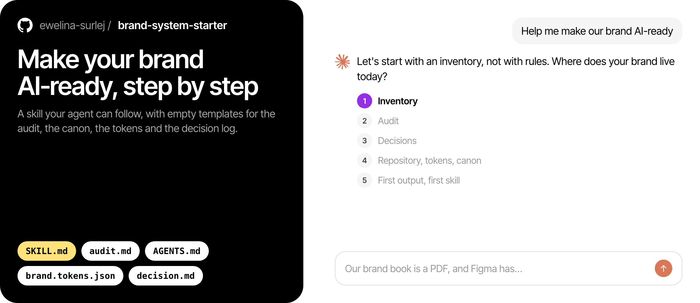

# Brand system starter



A skill and a set of templates that help an AI agent guide you through making your brand AI-ready: audit first, then a canon file, design tokens, assets in one place, generated outputs and format skills, all kept in one Git repository.

It comes with the article *[ARTICLE TITLE AND LINK]*. The article explains the thinking. This package lets your agent follow the same process with you.

Nothing here comes from a real brand. All templates are empty skeletons and examples.

## What's inside

```
brand-system-starter/
├── README.md              this file, for people
├── SKILL.md               the process, for the agent
└── templates/
    ├── audit.md           audit skeleton with FACT / CONCLUSION / DECISION / FIX labels
    ├── AGENTS.md          canon skeleton with the usual sections
    ├── CLAUDE.md          one line that makes Claude Code read AGENTS.md
    ├── brand.tokens.json  example tokens in DTCG format
    └── decision.md        template for one entry in the decision log (optional at first)
```

The decision log is optional at first. Start it when the first decision from the audit is made: a short note per decision, with what was chosen and why. The canon says *what* the rule is, the log says *why*.

## How to use it

### Claude Code (desktop app or terminal)

Copy the `brand-system-starter` folder into your skills folder:

- for all your projects: `~/.claude/skills/brand-system-starter/`
- for one project only: `.claude/skills/brand-system-starter/` inside that project

Then start a session and say something like: *"I need to make our brand AI-ready. Help me start."*

### Claude on the web or desktop chat

Download this folder as a ZIP and upload it as a skill in Settings, under Capabilities. Then start a chat with the same kind of request. Note that the chat can't work with files on your computer or with Git, so you will get the guidance and the templates, and you will save files yourself.

### Other agents (Cursor, Codex, Copilot and others)

Most agents don't use the skill format, but they can read Markdown. Put `SKILL.md` in your project and tell the agent to read it before you start, or paste its content into the agent's project instructions.

## What it will ask you for

- Where your brand lives today (brand book, Figma files, website, templates, asset folders)
- Read-only access to the tools you want it to audit, usually through connectors (MCP) for Figma and your website builder
- A Git repository, which you may need to ask your developers or IT for

## Before you start

Don't expect the agent to write your brand rules on day one. It will audit first, and the audit will probably show that your sources disagree more than you think. That is the most useful part.

## License

Free to use and adapt. A link back to the article is appreciated.
